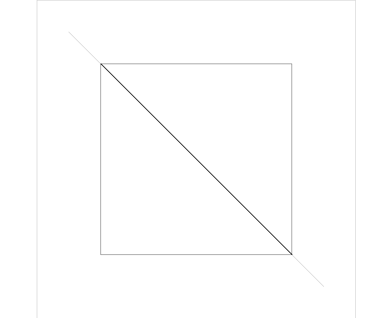
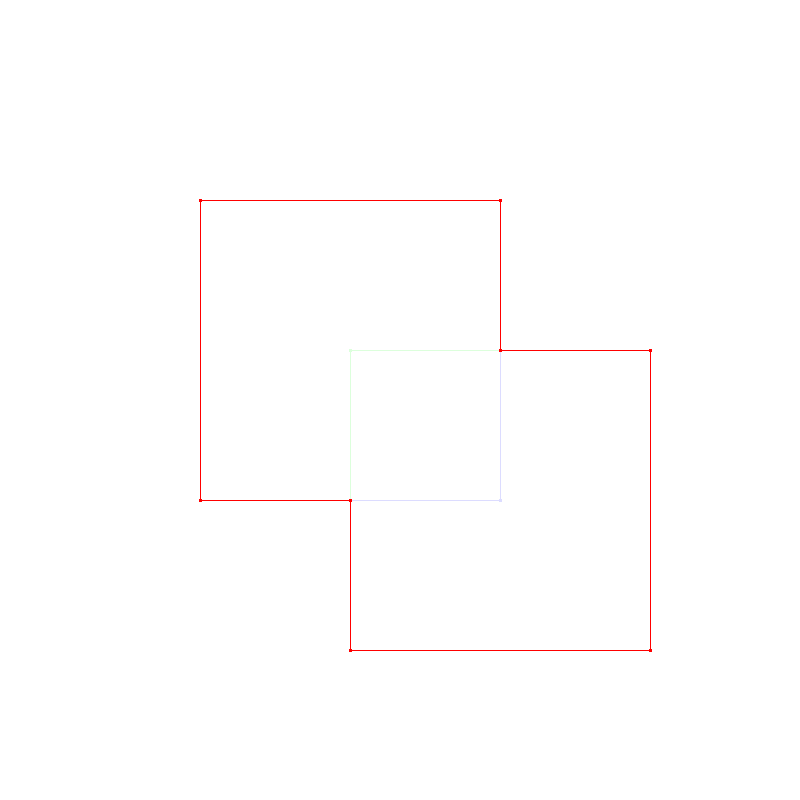

# 📐 GeometryAlgorithms

Визуальные эксперименты с кривыми Безье, отсечением и объединением многоугольников на C++.


## Возможности

- Кубические кривые Безье и управляющие многоугольники.
- Отсечение отрезка выпуклым окном по алгоритму Кируса — Бека.
- Отсечение многоугольников по алгоритму Сазерленда — Ходжмана.
- Экспериментальное объединение полигонов с примерами касания, вложенности и вырожденных фигур.
- Растеризация результатов в PNG без графического интерфейса.

## Сборка и запуск

Понадобятся C++17, CMake ≥ 3.16 и libpng с заголовками разработки.

```bash
cmake -S . -B build -DCMAKE_BUILD_TYPE=Release
cmake --build build --parallel
mkdir -p output
./build/curves_and_clipping
./build/polygon_union
```

Запускайте команды из корня репозитория. Изображения сохраняются в `output/`; внешние входные данные не нужны. В текущей конфигурации первая программа запускает 8 примеров отсечения отрезков. Сцены Безье и отсечения полигонов присутствуют в `generateAllTests()`, но закомментированы в исходнике; их можно включить отдельно. В Windows при многоконфигурационном генераторе укажите `--config Release` и используйте исполняемые файлы из `build/Release/`.

## Примеры





## Структура

- `src/curves_and_clipping.cpp` — Безье, отсечение и набор демонстрационных сцен.
- `src/polygon_union.cpp` — объединение и 17 заданных вручную случаев.
- `docs/` — примеры, полученные при запуске программ.

## Ограничения

Это учебные алгоритмы с вычислениями в плавающей точке. Для алгоритмов отсечения требуется выпуклое окно. Случайные сцены могут различаться между запусками. Наборы сцен создают изображения для проверки, но не являются автоматическими тестами геометрической корректности. Объединение для произвольных сложных полигонов требует дополнительной проверки.

## Проверка подготовки — 12 октября 2026

CMake-сборка и запуск обеих программ успешно выполнены на macOS (Apple Silicon). Получены 8 изображений отсечения и 34 изображения входов/результатов объединения для 17 сцен. Это проверка запуска и создания файлов, а не доказательство корректности геометрии.
